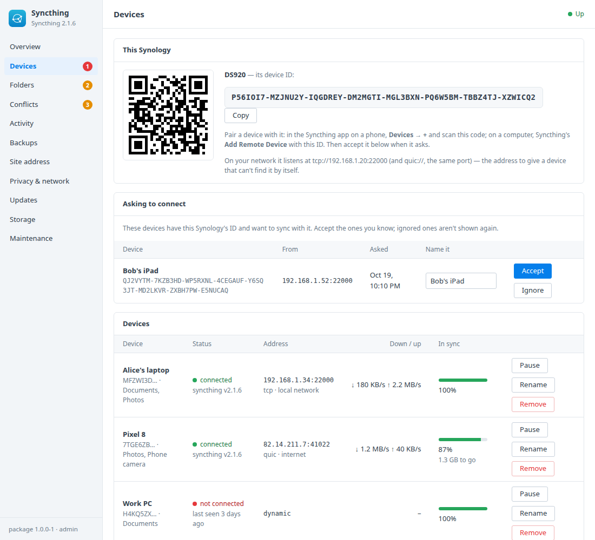
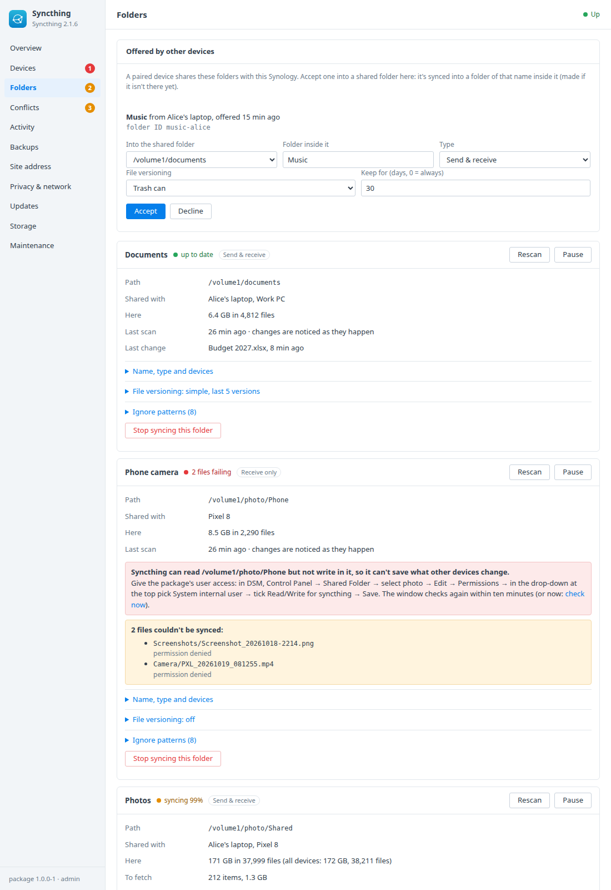
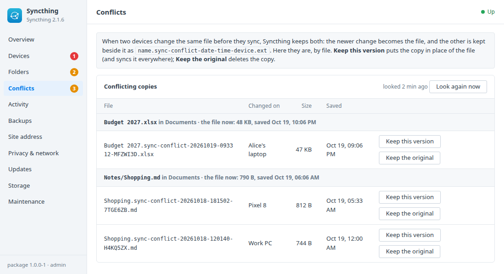
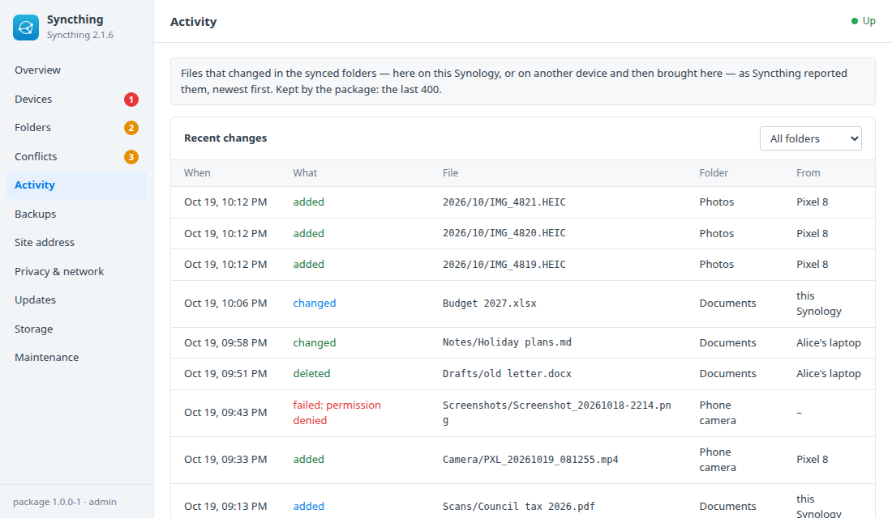
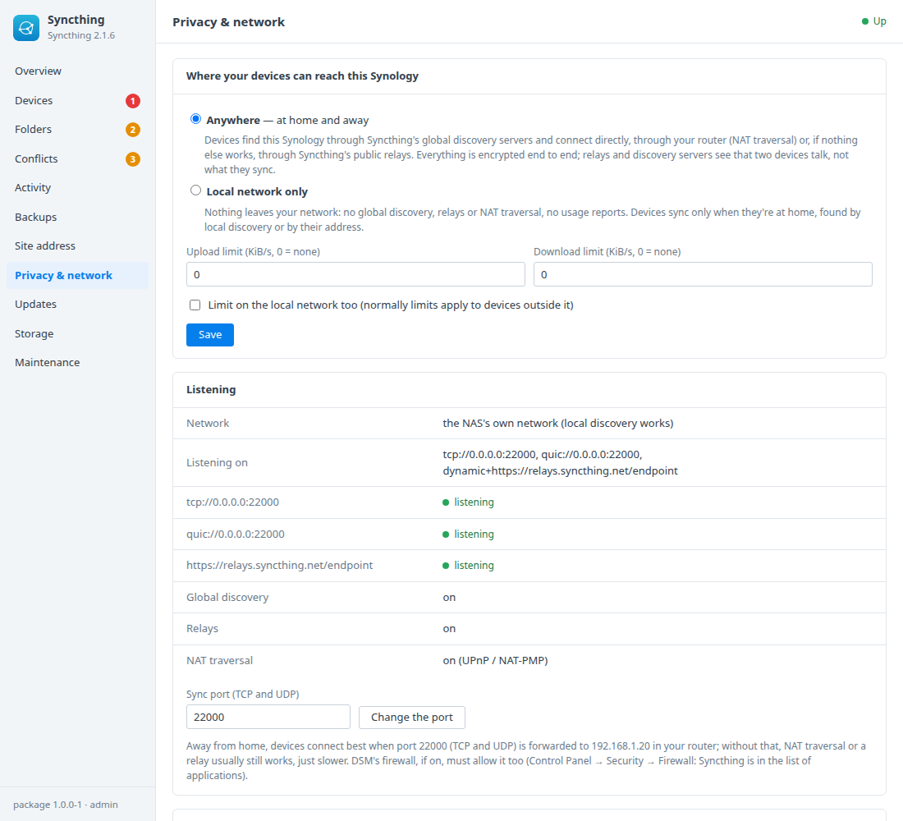
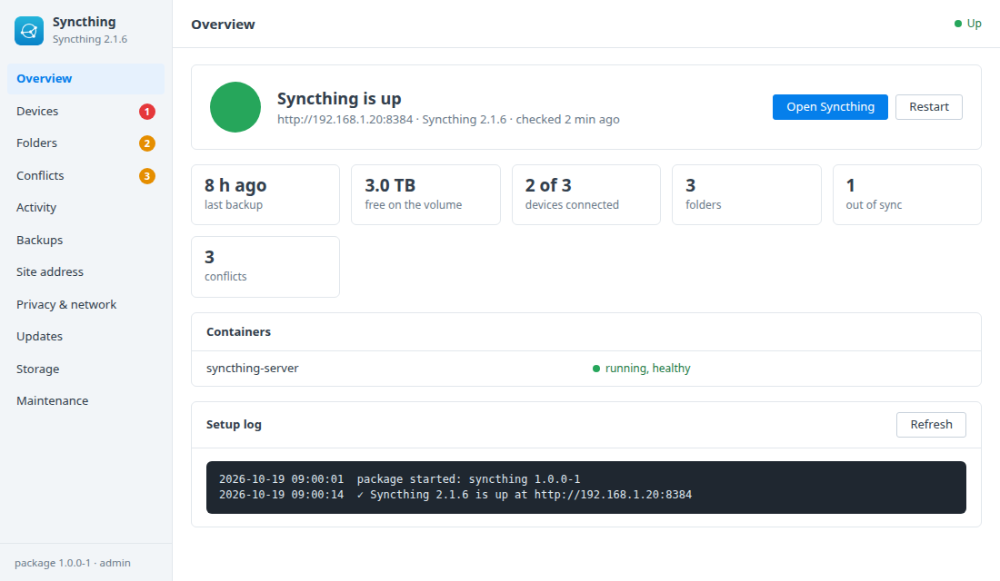

# Syncthing for Synology DSM

A DSM 7 package that installs [Syncthing](https://syncthing.net/) in Container
Manager. Syncthing keeps folders in step between your Synology, your computers
and your phone. It syncs directly between your own devices, encrypted, with no
cloud account in between. A DSM window adds:
- pairing devices: this Synology's ID as a QR code for the phone app, devices
  asking to connect, connection, transfer rates and how far each is in sync;
- syncing your shared folders, with a check that the package may write in
  each one and the exact steps to fix it when it can't;
- folders other devices offer, accepted into a shared folder you pick;
- conflicting copies of a file, sorted out with one click;
- what changed, in which folder, and on which device;
- local network only or anywhere, bandwidth limits, the password, backups that
  keep this Synology's identity, and updates.

Built on the [DSM app chassis](https://github.com/tombruton87/dsm-app-chassis).

## Download

### **[⬇ Download syncthing.spk](https://github.com/tombruton87/syncthing-dsm/releases/latest/download/syncthing.spk)**

[](https://github.com/tombruton87/syncthing-dsm/releases/latest)

That link always gives the newest version. Older ones are on the
[Releases](https://github.com/tombruton87/syncthing-dsm/releases) page.

Install: Package Center → Manual Install → the `.spk` (DSM 7.2.1+; Container
Manager is installed first if missing). The wizard asks for the NAS's address,
a port for Syncthing's web interface (8384 by default), a time zone, the sync
port (22000 by default, or a free one) and whether Syncthing may reach the
internet or stays on your network. The password for Syncthing's own web
interface is made at the first start and shown in the window.

**Permissions.** Syncthing runs as the package's own user, `syncthing`, so the
files it writes belong to that user and it can only reach the shared folders
you allow. For each shared folder you sync, give it Read/Write: **Control
Panel → Shared Folder → (the folder) → Edit → Permissions → "System internal
user" in the drop-down → syncthing → Read/Write**. The Folders tab tests this
by writing a file as that user, and says so beside the folder when it's
missing.

**Network.** By default Syncthing runs on the NAS's own network, so local
discovery finds your devices at home and they find it. The Site address tab
can move it to Docker's network instead, with the GUI and sync ports
published; local discovery doesn't cross into Docker's network, so devices are
then added by address. DSM's firewall, if it's on, lists Syncthing's web,
sync (TCP and UDP) and local discovery (UDP 21027) ports.

## What the DSM window adds

- **Overview** — devices connected, folders, folders out of sync, conflicts.
- **Devices**
  - This Synology's device ID with a QR code (Syncthing's phone apps scan it)
    and a Copy button, and its address on your network.
  - **Asking to connect:** devices that have this Synology's ID and want to
    pair, with their address. Accept one with a name, or ignore it for good.
  - Paired devices: connected or last seen, the address and whether it's on
    your network, through a relay or over the internet, download and upload
    rates, how far it's in sync, its folders. Pause, resume, rename, remove.
  - Add a device by its ID, with an address if it can't be found by itself.
- **Folders**
  - Each synced folder: name, path, type (send & receive, send only, receive
    only), the devices it's shared with, its state (up to date, scanning,
    syncing x%, out of sync, local changes, errors with the files that fail),
    local size and file count, last scan and last change.
  - Whether Syncthing may read and write there, tested as its own user, with
    the steps to fix it. A shared folder that's missing (renamed, a USB disk
    that's away) shows as waiting; the package never creates one.
  - Rescan, pause, **override** (send only) and **revert** (receive only),
    stop syncing (the files stay).
  - Edit the name, type and devices (checkboxes); **file versioning** (off,
    trash can, simple: the last N versions, or staggered) and **ignore
    patterns**.
  - **Add a folder** from a list of the Synology's shared folders, each marked
    with what Syncthing may do there. Ignore patterns come pre-filled for a
    Synology: `@eaDir` (DSM's thumbnails), `#recycle`, `#snapshot`,
    `.DS_Store`, `._*`, `Thumbs.db`, `desktop.ini` and
    `.SynologyWorkingDirectory`. They're also Syncthing's defaults for folders
    added in its own interface.
  - **Offered by other devices:** accept a folder into a shared folder (a
    folder of its name is made inside it), or decline it for good.
- **Conflicts** — every `*.sync-conflict-*` copy in the synced folders,
  grouped by the file it belongs to, with the device, size and date of each
  and of the file itself. **Keep this version** puts the copy in place of the
  file everywhere; **Keep the original** deletes the copy.
- **Activity** — the last 400 file changes: added, changed or deleted, the
  file, the folder, and whether it happened here or on which device. Files
  that failed to sync are in red. Filter by folder.
- **Privacy & network**
  - **Anywhere** (global discovery, NAT traversal, Syncthing's relays) or
    **local network only** (none of those, and no usage reports).
  - Upload and download limits, on the internet only or on your network too.
  - The sync port, where Syncthing listens and whether each listener and
    discovery works.
  - Syncthing's web interface: **Show password** (kept for DSM
    administrators) and **New password**.
- **DSM notifications** when a device asks to pair for the first time, when a
  folder has been out of sync or failing for more than 30 minutes, and when
  new conflicting copies appear.
- **Backups, updates, storage, maintenance**
  - Backups hold Syncthing's settings and this Synology's device certificate
    and key, so after a restore it's the same device to everyone it's paired
    with. Nightly or on demand, with restore.
  - **Updates:** the image is pinned to a tested release. When a newer one is
    on Docker Hub, the Updates tab offers it: a backup first, then the new
    image, and only the old Syncthing image is removed.
  - A newer package from inside DSM, a redacted support report, the logs, and
    removing Syncthing with everything in it (your synced files stay).

## Screenshots

| | |
|---|---|
|  |  |
|  |  |
|  |  |

## How it works

Syncthing (`syncthing/syncthing`, pinned) runs as one container, as the
package's user (`PUID`/`PGID`). Its settings, keys and index are in the
`syncthing_config` volume. The package talks to it through its REST API with
a key of its own (`STGUIAPIKEY`), kept in the root-only settings file.

The first start names the device after the Synology, sets the GUI user
`admin` with a strong password (shown once in the window and kept for
**Show password**), makes the DSM ignore patterns Syncthing's defaults and
applies the privacy choice. Syncthing's own "Default Folder" isn't made.

Synced folders are your shared folders. Each one is mounted read-write at its
own path (`/volume1/photos` stays `/volume1/photos`), in one of eight places
in the compose file. Folders inside a shared folder that's already mounted
need no place of their own. Places follow Syncthing's folder list, so folders
added in Syncthing's own interface (inside a shared folder) or brought back by
a restore are mounted too, after a short restart. A shared folder that isn't
there gets an empty placeholder from the package's share until it is.

Activity comes from Syncthing's events (`LocalChangeDetected`,
`RemoteChangeDetected`, and `ItemFinished` with an error), which Syncthing
keeps only in memory; the package collects them. Conflicts are found by
looking for `*.sync-conflict-*` files inside Syncthing's container, and
resolved there, as the package's user.

Backups copy `config.xml`, `cert.pem` and `key.pem` (the device's identity)
and the GUI's certificate while Syncthing runs: Syncthing writes `config.xml`
whole and renames it into place, so the copy is consistent. The index is left
out. After a restore Syncthing reads the folders again and rebuilds it, and
the kept GUI password is put back.

## Layout

```
chassis/          the DSM app chassis (git submodule)
package.conf      name, title, services, volumes, images, ports, texts
app/compose.yaml  Syncthing, with eight places for shared folders
setup/app.sh      the hooks: first start, network, places and permissions, devices, folders,
                  conflicts, activity, privacy, notifications, backups, updates
ui/               Devices, Folders, Conflicts, Activity and Privacy & network tabs; CGI validation
wizard/           the Syncthing page of the install wizard (sync port, privacy)
tests/            CGI checks and steps for the chassis harness, with a second Syncthing as "Alice's laptop"
```

Test on any Linux box with Docker:

```bash
export E2E_DIR=/tmp/st-e2e
chassis/tests/e2e.sh . up
chassis/tests/e2e.sh . act      # the chassis's own steps: backup, report, settings, restore, restart
tests/e2e-part.sh 1             # first start, pairing, a folder both ways, ignore patterns, versioning, activity
tests/e2e-part.sh 2             # a folder offered by Alice (receive only, revert), declining, a folder it can't write
tests/e2e-part.sh 3             # conflicts resolved both ways, folder and device actions, ignoring a device
tests/e2e-part.sh 4             # privacy, sync port, new password, network, backup and restore, the update path
chassis/tests/e2e.sh . wipe; chassis/tests/e2e.sh . clean
```

The tests run the package's Syncthing on the host's network (ports 8384,
22000 and 21027 must be free) and "Alice's laptop" on Docker's network.

Release: bump `VERSION`, add the changes to `CHANGELOG.md`, build, then attach
the package twice, under its versioned name and as `syncthing.spk`:

```bash
cp dist/syncthing-X.Y.Z-1.spk /tmp/syncthing.spk
gh release create vX.Y.Z dist/syncthing-X.Y.Z-1.spk /tmp/syncthing.spk
```

Build: `chassis/build.sh . N`.

## Credits

The icon is Syncthing's own mark on a DSM-style tile in Syncthing's blues.
Syncthing is made by the Syncthing Foundation and contributors and is
MPL-2.0 licensed. This package is not affiliated with Syncthing or Synology.
